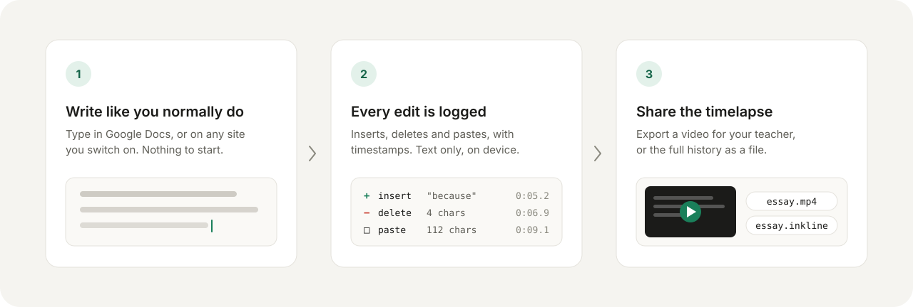
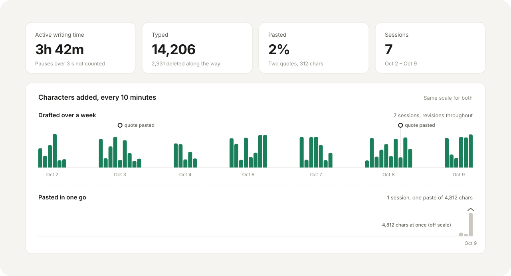

<p align="center">
  
</p>

<p align="center">
  <b>A browser extension that records how you write, and plays it back as a timelapse.</b><br>
  Google Docs is recorded automatically. Everything stays on your device.
</p>

<p align="center">
  <a href="#install">Install</a> ·
  <a href="#how-it-works">How it works</a> ·
  <a href="#what-a-teacher-sees">What a teacher sees</a> ·
  <a href="#privacy">Privacy</a> ·
  <a href="#under-the-hood">Under the hood</a>
</p>

---

## Why Inkline

AI detectors get it wrong, and when they do, it is on you to show that you wrote
your own work. A finished essay can't show that. The way it came together can:
drafts that grow over days, sentences rewritten, words cut, a quote dropped in
from a source.

Inkline keeps that record while you write, so if anyone asks, you can hand them
a short video of your essay being written, along with plain numbers on how much
was typed and how much was pasted.

- **No setup per document.** Open a Google Doc and write. That's it.
- **Built to be shared.** Export an MP4 your teacher can watch anywhere, no
  extension needed.
- **Tiny and private.** About 7 KB per hour of writing, stored only in your
  browser.

## How it works

<p align="center">
  
</p>

Inkline never takes screenshots and never reads anything but the text you
write. It stores each change as a tiny record (inserted text, deleted length or
pasted text, plus when it happened), then rebuilds the document from those
records when you press play.

## What a teacher sees

<p align="center">
  
</p>

The playback page shows, for each recording:

| Feature | What it does |
| --- | --- |
| **Timelapse** | Text appears and disappears as it was written. Speed 1× to 50×, scrubber, and *Skip idle*, which squeezes every pause over 3 seconds down to half a second. |
| **Pastes** | Tinted and labelled with their size, so a pasted quote is easy to tell apart from typed text. |
| **Deletions** | Flash in red strikethrough before they disappear, so revisions are visible. |
| **Stats** | Active writing time, characters typed vs. pasted, characters deleted, and number of sessions. |
| **Export video** | Saves the timelapse as a 1280×720 MP4 (WebM if the browser can't encode MP4). |
| **Export file** | Saves the full history as a `.inkline` file that another Inkline user can import and replay. |

### What it can and can't show

Inkline shows *how* a document was produced: when text arrived, in what size of
chunks, and how much it was revised. That is strong context, not proof of
authorship on its own. Someone could retype text from elsewhere, though steady
typing with no pauses or revisions looks different from real drafting. Use it
alongside Google Docs' own version history and your notes and sources.

## Install

Inkline isn't on the Chrome Web Store yet. Load it from source:

1. Download this repository (**Code → Download ZIP**) and unzip it, or clone it.
2. Open `chrome://extensions` (Arc: `arc://extensions`, Edge: `edge://extensions`).
3. Turn on **Developer mode**.
4. Click **Load unpacked** and pick the folder that contains `manifest.json`.
5. Pin Inkline to your toolbar.

Works in Chrome, Arc, Edge, Brave and other Chromium browsers. Inkline uses a
toolbar popup and a regular extension page, not the side panel, so it works in
Arc too.

Google Docs tabs that were already open start recording when the extension
loads; if one doesn't, reload that tab.

## Using it

- **Google Docs**: write as usual. A small green dot in the bottom-left corner
  means Inkline is attached. Nothing is saved until you edit.
- **Other sites** (for example your school's LMS): click the Inkline toolbar
  button and switch on **Record on this site**. The browser asks for permission
  for that one site. Inkline records `<textarea>`, text inputs and rich-text
  editors (including TinyMCE and CKEditor). Password and payment fields are
  never recorded. Switch it off from the same popup.
- **Watch and share**: popup → **Open recordings**.
- **Check it's working**: on a Google Doc, the popup's **Status** section shows
  whether the recorder is attached, how many keys it has seen and whether its
  last save worked.

## Privacy

- No accounts, no servers, no analytics, no remote code.
- Recordings live in your browser's own storage and leave it only when you
  export one.
- The only network request Inkline makes is fetching the plain-text export of
  the Google Doc you are editing, from Google, to double-check its record
  (Google serves that file from `googleusercontent.com`). The text is compared
  in memory and never stored.
- Permissions: `storage`, `activeTab`, `scripting`, and access to
  `docs.google.com`. Other sites are asked for one at a time, only when you
  switch them on, and released when you switch them off.

## Under the hood

### Recording format

A recording is a list of sessions; each session is a list of ops:

```js
{ t: 5200, op: "insert", pos: 118, text: "because", d: 840 }
{ t: 6900, op: "delete", pos: 121, len: 4, d: 270 }
{ t: 9100, op: "paste",  pos: 121, text: "…more than 40 characters…" }
```

| Field | Meaning |
| --- | --- |
| `t` | ms since the session started |
| `op` | `insert`, `delete`, or `paste` (more than 40 characters in one input event) |
| `pos` | character offset at that moment |
| `text` / `len` | inserted text, or number of characters deleted |
| `d` | on merged runs: time from first to last keystroke |
| `sync` | the change wasn't typed in a recorded session (text already there, edits made elsewhere) |

Single-character inserts typed within 1.5 s of each other at adjacent positions
are merged into one op; backspace runs too. Each session is stored as one
gzip'd JSON chunk (`CompressionStream`) in IndexedDB, with timestamps
delta-encoded:

```js
{ v: 1, start: 1791800000000, ops: [[dt, code, pos, payload, d?], ...] }
```

`code` is 0 insert, 1 delete, 2 paste, plus 4 if `sync`. Raw times are always
stored; idle time is only squeezed at playback. A `.inkline` export is the
whole recording as one gzip'd JSON document.

### Google Docs

Docs draws text on a canvas, so there is nothing readable in the page. Inkline
listens to key, paste and composition events on Docs' hidden input frame and
keeps its own estimate of the text and cursor. Those ops are provisional. When
typing pauses, Inkline fetches the document's plain-text export and either
keeps them (they matched), shifts them (right keystrokes, wrong place), or
replaces them with a diff spread over the same time span. The stored history
therefore always replays to the real document text.

All Docs selectors and timings live in
[`src/content/docs.config.js`](src/content/docs.config.js). If Docs changes its
markup, that is the file to update.

Known limits: edits by collaborators made while you type are attributed to you;
lists and tables appear the way Google's plain-text export writes them; text in
comments, the title or the find box is not recorded.

### Project layout

```
manifest.json
src/
  background.js        service worker: storage writes, per-site script registration
  shared/              op model, diff, drift correction, timeline, gzip, storage
  content/             Google Docs recorder, opt-in site recorder, status dot
  popup/               toolbar popup
  player/              recordings list, timelapse player, video export
tests/                 dependency-free unit tests
docs/images/           README graphics (generated by scripts/make_graphics.py)
```

## Development

```bash
npm test
```

Runs the unit tests with Node 18+ (no dependencies): op merging and encoding,
idle compression, the storage round-trip and size budget, and the Docs drift
correction. Or serve the folder and open `tests/index.html` in a browser.

After editing, press the reload arrow on Inkline's card in
`chrome://extensions`, then reload the pages you are testing.

To regenerate the README graphics:

```bash
python3 scripts/make_graphics.py
```

## License

[MIT](LICENSE)
